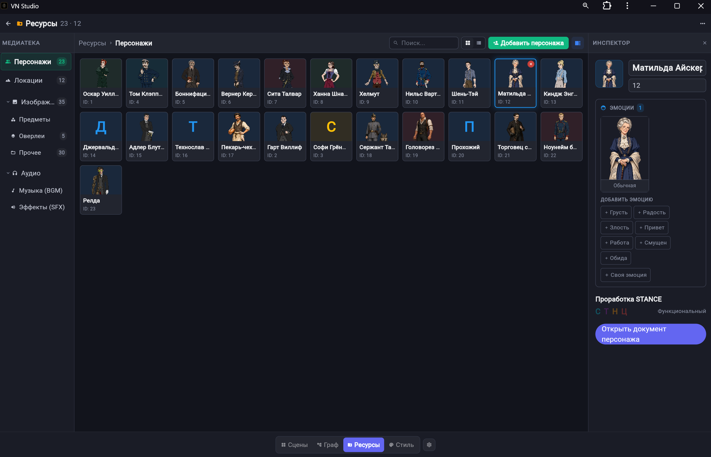
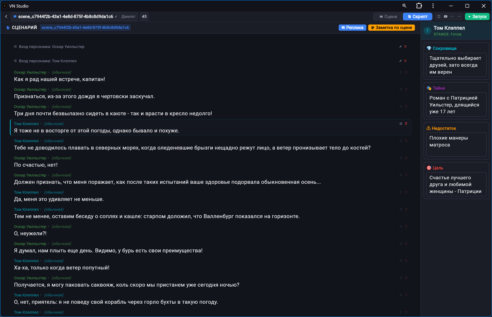

# Как удобно прорабатывать персонажей новеллы

> **ДИСКЛЕЙМЕР**:
>
> При написании этого раздела мы в значительной степени опирались на книгу Александра Молчанова "Букварь Сценариста". Он не нарративный дизайнер видеоигр, а драматург и сценарист. Но его советы нам показались подходящими и для нашей сферы, поэтому спешим с вами ими поделиться.
>
> Насколько они работают мы узнаем по продажам наших новелл-флагманов 🤷

## СТаНЦия - 4 элемента персонажа

СТаНЦия - это мнемноика, чтобы запомнить ключевые компоненты персонажа:

- Сокровища
- Тайна
- Недостатки
- Цели

Разберем каждый из этих компонентов отдельно.

### Сокровища

Сокровища - это те качества или доступные ресурсы персонажа, которые заставят игрока хотеть быть похожим на него. Что важно, сокровища обязательно должны выделять героя на фоне остальных персонажей. Даже если этот персонаж - "плохой" и вы хотите чтобы он нарочито унизительно проиграл "хорошим" героям - не стоит оставлять его без сокровищ.
Ваши герои должны побеждать или терпеть поражение от антогонистов по какой-то объективной причине, иначе игроку будет невозможно понять, почему ему не дают победить. Да и когда победа будет достигнута, ценность ее будет сомнительной.

Вот примеры хороших сокровищ:

- `Идеальная дисциплина` - персонаж никогда не тратит время понапрасну, и пока великий герой пьет пиво в таверне, этот злой негодяй читает трактат о стратегии и проводит учения.
- `Обладает палантиром` и периодически видит действия героев - хорошо объясняет, как злодей им противодействует
- `Чистая душа и желание всем помочь` - что бы не говорили даже самые суровые циники, подобная черта очень привлекательна на бумаге, и многим хотелось бы ее иметь

Важный момент: сокровище именно что **выделяет** вашего героя из толпы. Т.е., если у вас половина персонажей - рыцари, не стоит им всем в сокровища записывать `могучий и умелый воин`. Гораздо рациональнее вписать одному `лучший воин`, а остальным - что-то другое, что делает их индивидуальными.

> Сокровищ может быть много. Но следует соблюдать умеренность, чтобы не замыливать их друг другом.

### Тайна

Тайна - это то, что игроку не известно о вашем пероснаже на момент знакомства с героем.

Основная ее задача - чтобы игрок не просто смотрел на героя, а имел причину думать о нем. Кроме того, от персонажа, часть истории которого скрыта, по ходу истории игрок будет ожидать какого-то дополнительного раскрытия и не упускать его из виду.

Вот примеры хороших тайн:

- как слабак Трикс Солье смог победить портового драчуна в бою?
- откуда рыцарь-череп знает апостолов Длани?
- что делал Пин в сороковые годы?

Из этих примеров ясно, что можно поступать по разному: можно дать ответ уже через 15-20 минут чтения, можно - спустя несколько лет с первого появления героя, а можно и вовсе никогда не открывать тайну, оставляя фанатам простор для интерпретации (как это сделали в случае со Смешариками).

Еще один интересный нюанс: тайна персонажа не всегда подразумевает, что он сам что-то скрывает. Ничуть не хуже, когда персонаж сам находится в неведении - как в первом примере, когда Трикс Солье неосознанно создал заклинание, произнося хвастливую речь для устрашения противника.

### Недостаток

> [Майкл Скотт]: Давайте я расскажу вам о моих основных слабостях:
>
> - Я слишком усердно работаю
> - Я слишком забочусь о компании
> - И иногда я выкладываюсь на работе слишком сильно
>
> [Дэвид Уоллес]: Окей... А ваши сильные стороны?
>
> [Майкл Скотт]: Ну, вообще-то мои слабости это и есть мои сильные стороны.

Недостаток - это то, что делает вашего героя более реальным и человечным. Игроку сложно себя ассоциировать с персонажем, который безукоризненно идеален, да и поражения такого совершенства в человеческой форме будет сложно объяснить. Вот примеры недостатков, которые мы выдавали нашим персонажам:

- Не способен победить в физической конфронтации - хороший недостаток, потому что заставляет сценариста придумывать нестандартные по сравнению с другими героями разрешения конфликтов с его участием.
- Высокомерен по отношению к чужим культурам - дает почву для множества конфликтов (например, при отсутствии у друзей интереса к благородной игре в крокет)
- Психопат (не способен выстроить эмоциональную связь с другими героями) - тоже дает хорошую почву для конфликтов и пищу к размышлению для игрока (стоят ли того сокровища, идущие вместе с таким недостатком?)

### Цель

Под целью подразумевается то, к чему герой стремится глобально в своей жизни, а не то, к чему вы хотите чтобы он пришел к концу вашей новеллы.

Нормально, герой должен иметь либо одну цель, либо две. С одной целью все очевидно. Рассмотрим, как работают две цели. Обычно это выглядит так:

- **Мнимая цель** - герой ошибочно думает, что это то, чего он хочет от жизни
- **Истинная цель** - то, чего герой хочет неосознанно, и что для него намного важней мнимой цели.

Самый стандартный расклад - герой думает (и вслух заявляет), что он хочет денег и славы, но в душе он очень одинок, и сам того не зная мечтает найти родственную душу чтобы вместе смотреть корейские дорамы.

---

Иногда кажется, что могут быть дополнительные варианты. Нам приходило в голову такое:

1. Герой может менять свою единственную цель. Например, в "Атаке титанов" изначально Габи хочет уничтожить всех жителей Парадиса, но, познакомившись с ними, меняет свое мнение об элдийском народе и этнической политике Марли.

    Может показаться, что ее цель сменилась с _"убить всех ~~человеков~~ демонов с Парадиса"_ на _"прекратить войну и взаимное уничтожение"_. Но после некоторых размышлений мы пришли к тому, что ее драйвер ее действий вообще не менялся: _"защитить хороших людей любой ценой"_. Изменилось только ее понимание мира, что привело к изменению действий

2. У героя может быть тайная цель, которая раскрывается в конце, создавая неожиданный твист. До этого же герой притворяется, будто бы у него совсем иная цель.

    Скорее всего, это должно мало волновать автора. Герой действует исходя из своей **реальной** цели, даже следуя притворной.

## Как удобно писать персонажа?

Следующий фремворк описания персонажа пердставляется наиболее эффективным:

1. Определите, какое место пресонаж занимает в истории - кто он в социуме, как с ним взаимодействует игрок. Например "молодой странствующий торговец, продающий игроку амулеты от разной нечисти"
2. Начните писать его предысторию - как он пришел к своей текущей позиции в мире игры, какие препятствия встречались на его пути, какие люди его окружали
3. По мере написания предыстории вы будете постепенно понимать, какие сокровища и недостатки проистекают из прошлого персонажа. Также, вы увидите, какие элементы биографии лучше поначалу скрыть ради интриги. Заполнять СТНЦ параллельно с предысторией - отличная идея, так как взаимозависимы

## Пример - Ежик Ковальски

Рассмотрим применение фреймворка СТНЦ на примере создания нового персонажа для вселенной Ведьмака (не берем своих персонажей новелл, чтобы избежать спойлеров). В этой вселенной много умелых воинов, поэтому хочется сделать кого-то более мирного и лампового.

> **ДИСКЛЕЙМЕР**
>
> Не претендуем на экспертность в лоре Ведьмака. Просто мы его любим и большинство читателей с ней знакомо, поэтому для упражнения взяли именно ее.

#### Роль персонажа

Ежи́к (не Ё!) Ковальски - 35-летний декан химической кафедры Оксенфуртского университета (исследовательский фокус - технологии ферментирования и пивоварения) и владелец малой пивоварни, унаследованной от отца.

Основные связи в игре:

- `Вернон Роше` - командир “Синих полосок”, которые финансирует Ежик
- `Лотка …` - симпатичная алхимичка, продающая химические реагенты для пива. Любовный интерес
- `Лев Птачек` - ректор университета, непосредственный начальник
- `Геральт из Ривии` - эпизодический помощник
- `Гнушек Ковальски` - отец, ныне покойный
- `Маринетт Ковальски` - мать, ныне покойная

#### Предыстория

Ежик родился в семье потомственного оксенфуртского пивовара с темерскими корнями. **Гнушек Ковальски** был простоватым, но трудолюбивым и добросердечным мужчиной. Он искренне любил свою семью, и был готов усердно работать от рассвета и до заката, лишь бы не только прокормить семью, но и принести домой петушка на палочке для Ежика и красивую шаль - жене. Это усердие позволило сделать пивоварню прибыльным бизнесом после нескольких поколений упадка, но также привело и к ранней его кончине от сердечной недостаточности.

**Маринетт Ковальски** была доброй и тихой женщиной, хранительницей очага и матриархом семьи. Хотя добытчиком и был Гнушекк (Маринетт доверяла его деловой интуиции и профессионализму, и не лезла в его пивной бизнес), именно Маринетт распоряжалась семейным бюджетом, работами по благоустройству дома, а также каждым чихом мужа и сына вне пивоварни. При этом, она всегда управляла домочадцами с ласковой улыбкой и никогда не повышала свой голос - ее обходительность заставляла всех немедленно исполнять все ее просьбы без дополнительных понуканий.

Из-за врожденной дотошности, Ежика с детства раздражало то, что отец и его помощники делают пиво по традиционному рецепту, а не пытаются глубоко разобраться в том, как работает ферментирование и как образуются разные вкусы. Поэтому, помимо изучения грамоты и арифметики у жрецов в храме, Ежик занимался самостоятельно по алхимической книге, которую он выклянчил у отца.

Когда родители умерли, юноша не смог оставаться в опустевшем доме. Поэтому, он оставил управление пивоварней на управляющего, а сам поступил в Оксенфуртскую академию, оплатив учебу из капитала, оставленного отцом. Ежик переехал в квартиру, выделенную Оксенфуртским университетом на кампусе. Однако, он не стал обставлять ее, потому что не хочет считать ее своим домом: он верит, что это лишь временное пристанище, и он скоро вернется в свой истинный дом, наполнив его стены смехом любимой жены и топотом детских ножек. Поэтому, его городская квартира - это идеально прибранное и аккуратное место, но при этом оно совершенно не вызывает ощущения уюта.

Ежик преуспел в учебе, и его академическая карьера пошла в гору. Новые знания позволили ему также оптимизировать процессы производства пива и усовершенствовать вкус, что сделало его пивоварню еще более успешной. Хотя не обошлось и без падений: порой чрезмерная уверенность в своих научных знаниях и пренебрежение к традициям выливалось в дорогостоящие и совершенно неудачные эксперименты с рецептурами.

Занимаясь экспериментами, он часто нуждался в ингредиентах. Так судьба свела его с Лоткой - девушкой немногим старше его, державшей лавку алхимических товаров неподалеку от университета. Несмотря на то, что они отлично сошлись характерами, Ежик находил общение с ней затруднительным - в обществе девушки он чувствовал себя неуклюжим влюбленным болваном, а не солидным ученым и пивоваром. Проблемой была и ненависть Лотки ко всему темерскому (в значительной степени - из-за слухов о Фольтесте, а также из-за поддержки темерскими королями сепаратизма Новиграда). Ежик же, напротив, горделся темерским наследием и жаждал возрождения королевства его предков, являясь одним из крупнейших частных жертвователей Синих Полосок (естественно, тайно).

Когда Ежик был назначен деканом химического факультета, его жизнь стала еще сложнее: новые административные обязанности включали, например, пресечение инакомыслия среди студентов факультета по приказанию ректора - что шло вразрез с ценностями Ежика. Однако он не имел силы воли, чтобы противостоять навязываемой политике напрямую, поэтому либо подчинялся, либо саботировал приказы, когда находил для того безопасный путь.

#### Сокровища:

- Идеализм. Хотя у Ежика не хватает духовных сил защищать справедливость и добродетель, он всегда стремиться их поддержать мирными и безопасными для него путями.
  глубокие познания в ботанике и химии, позволяющие выводить новые сорта пива превосходного качества и вкуса
- Маленькая пивоварня с отличной репутацией, унаследованная от отца (а до него - деда)
- Высокий интеллект и дотошность

#### Тайна:

- Его семья происходит из Темерии, и Ежик Ковальски является темерским националистом. После падения Темерии Ковальски тайно посылал пожертвования отряду “Синих полосок”, возглавляемому Вернону Роше, в надежде что они восстановят его любимую прародину

#### Недостатки:

- Вздорный и слегка высокомерный характер (он часто обучает студентов, и привык к тому, что у него есть право указать попавшим впросак людям на их ошибки)
- Излишняя педантичность
- Пьянство (регулярное, но не болезненное)
- Неловкость в общении с прекрасным полом: Ковальски большую часть детства провел в подвалах пивоварни, и мало общался с людьми, кроме суровых мужиков-работников пивоварни. В академии ситуация была схожей. Поэтому, он понятия не имеет, как общаться с женщинами. Не помогает ему и профессиональная деформация внешности - Пивной Животик
- Отсутствие доблести и “тепличность” воспитания - Ковальски не может даже представить себя физически защищающим дорогих ему людей или свои идеалы, так как жутко боится боли и смерти в бою, да и любой другой опасности (поэтому, несмотря на просьбы Роше, он до сих пор не стал шпионом для темерских партизан)

#### Цель

- Восстановить Темерию, не участвуя в сражениях или иных опасных мероприятиях лично.
- Покорить Лотку

## Как это использовать в Moirai?

На этом материал о самой СТаНЦии закончен - использовать методику полезно независимо от того, в каком редакторе вы работаете. Дальше - расскажем, как мы интегрировали её в Moirai VN Studio, чтобы СТаНЦией было удобно пользоваться при разработке визуальных новелл.

Если вы откроете вкладку ресурсы и выделите вашего персонажа, в панели редактирования персонажа вы увидете индикаторы заполнения СТНЦ, а также кнопку, позволяющую открыть документ с описанием персонажа.

Здесь вы можете добавить персонажу произвольное количество сокровищ, тайн и недостатков, а также сформулировать его явную и истинную цели.

Помимо СТНЦ, здесь доступна проработка следующих аспектов личности:

- Стиль речи персонажа (он обозначен как голос)
- Отношения с другими персонажами
- Рекации на внешние раздражители
- Его предыстория

Если бы все эти данные приходилось постоянно держать в голове, толку от этого инструмента было бы немного. Поэтому мы интегрировали эту информацию в редактор диалогов, чтобы вы могли писать реплики персонажей, имея перед взглядом описания их личностей.

Откройте редактор диалога и перейдите в режим сценариста (кнопка "Скрипт" в правом верхнем углу). Этот режим мы добавили специально для того, чтобы вы могли писать диалоги сфокусировавшись на персонажах и сюжете, не отвлекаясь на верстку эффектов и кода.

Когда вы выделите реплику, справа будет показана панель с СТНЦ персонажа, который ее произносит. мы надеемся, что это поможет вам всегда учитывать характер ваших персонажей в диалогах, что улучшит нарратив в ваших играх и позволит вам покорить большую аудиторию.

## Получить доступ к редактору Moirai

Команда Moirai будет и дальше стремиться сделать процесс разработки ВН более эффективным и комфортным для нас и для вас.

И СТаНЦия - лишь одна из вещей, которые мы встроили в редактор, чтобы убрать рутину из разработки VN и расширить возможности авторов. В VN Studio уже есть граф ветвлений, комфортная работа с переменными, визуальный редактор диалогов с live-превью, работа с локализацией, поддержка интерактивных и анимированных фонов.

Если вы хотите получить все преимущества разработки новелл в редакторе Moirai (возможность интеграции анимированных и интерактивных фонов сделанных в Rive, комфортное управление переменными сценария и ветвлением сюжета с помощью графа и многое, многое другое), вы можете принять участие в бета-тесте редактора. Нужно всего лишь подать заявку на участие в бете [по этой ссылке](https://moirai.clds.ru/).

Ну а если вы пока не готовы менять ваш движок для новелл на новый, но хотите наблюдать за ходом разработки Moirai VN Studio, получать полезные для нарративных дизайнеров и художников материалы а также сделить за разработкой наших новелл - вы можете следить за обновлениями в нашем официальном [Telegram-канале](https://t.me/Moirai_Visual_Novels)
