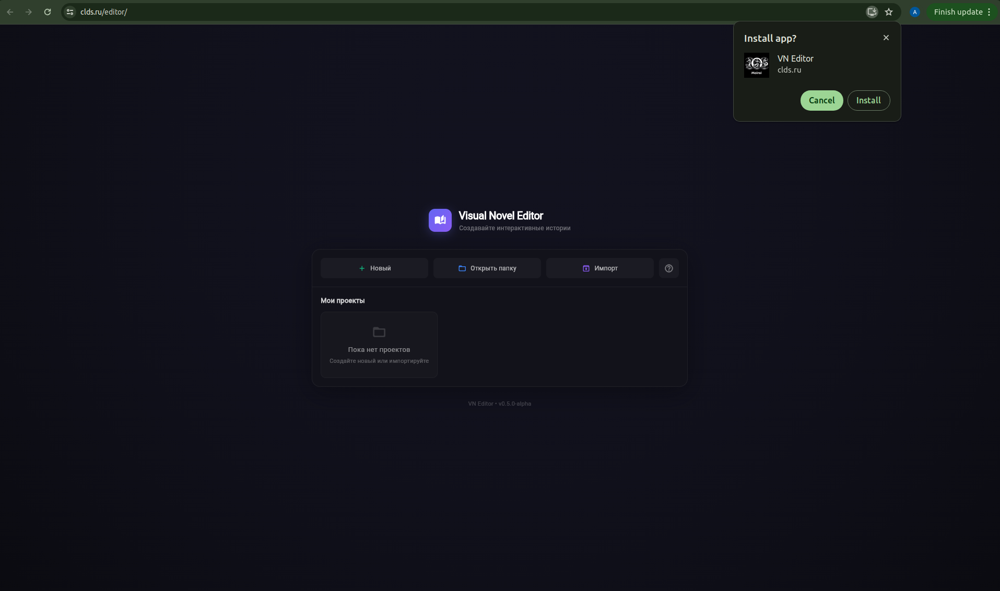

# Установка Moirai Editor

Moirai Editor не обязательно устанавливать на ваше устройство: он является облачным сервисом, и открывается в браузере по [этой ссылке](https://moirai.clds.ru/editor/).

Тем не менее, для вашего удобства и экономии трафика, мы рекомендуем все же установить редактор на ваше устройство как PWA (Progressive Web App). Это делается в два клика в браузере, как показано на картинке:

> ❗     **Используйте правильный браузер**
>
> Из-за работы с файлами проекта, Moirai Editor требует некоторого функционала от браузера, в котором он запущен. Поэтому, для работы с редактором потребуется любой Chromium-совместимый браузер:
> - Google Chrome
> - Microsoft Edge
> - Яндекс Браузер
> - Opera и пр.
> 
> Для несовместимых браузеров (Safari, Firefox и пр.) мы не можем гарантировать работу редактора. Если вы встретились с проблемой в ходе эксплуатации редактора, пожалуйста, убедитесь что вы используете браузер из перечня поддерживаемых.

Теперь вы готовы создать свою первую новеллу! Далее - [создание проекта](1_project-creation.md)