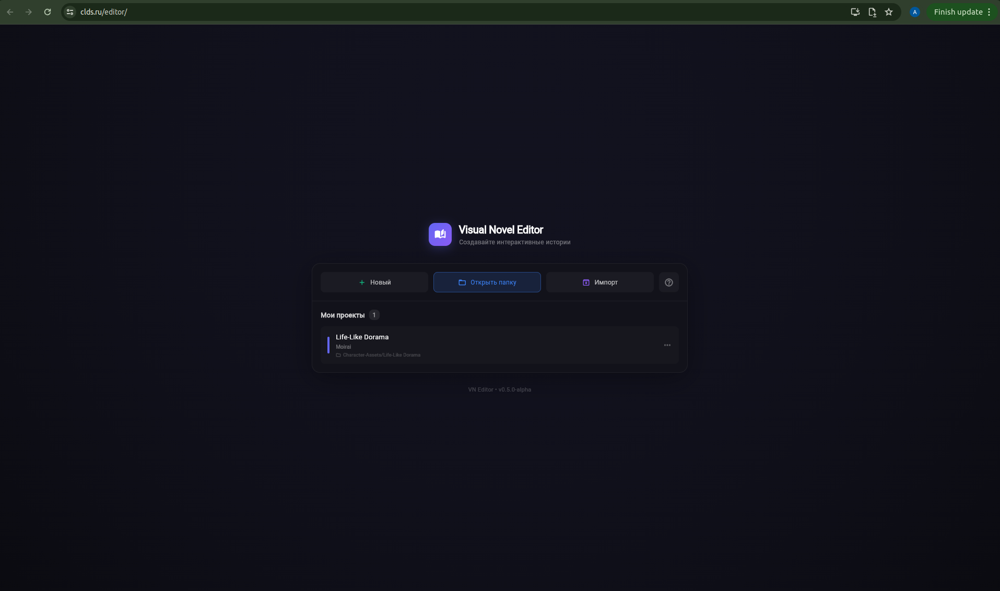
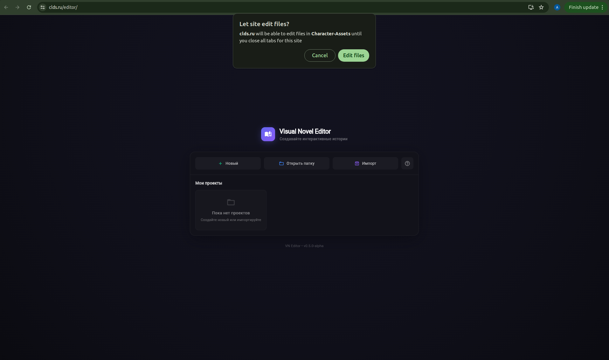
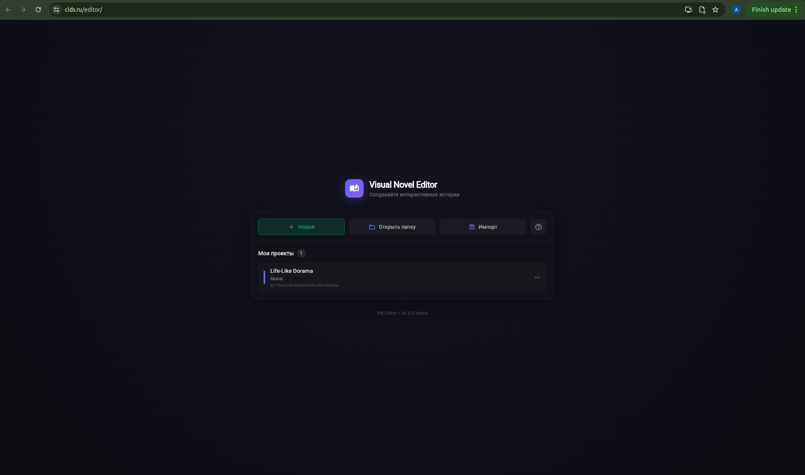
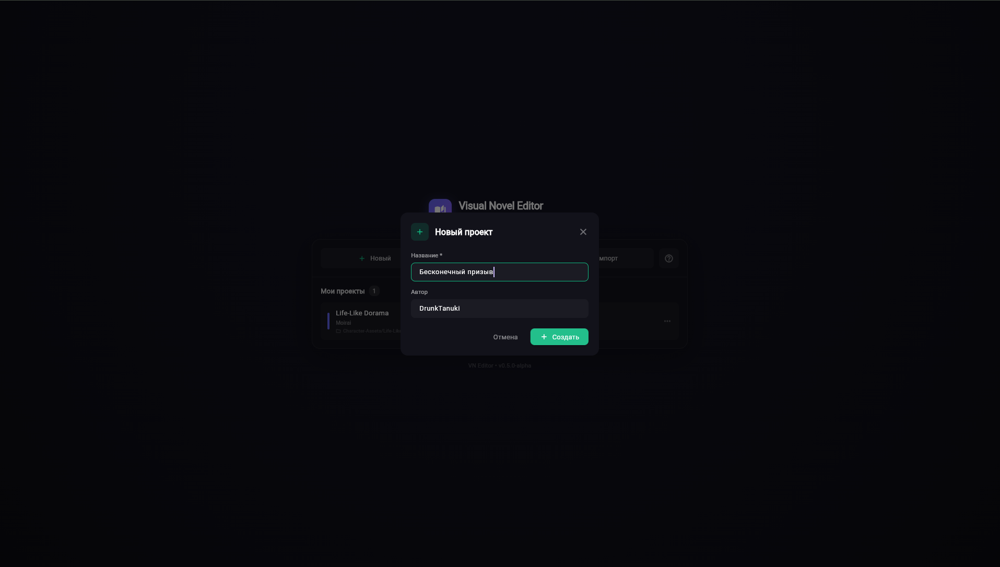
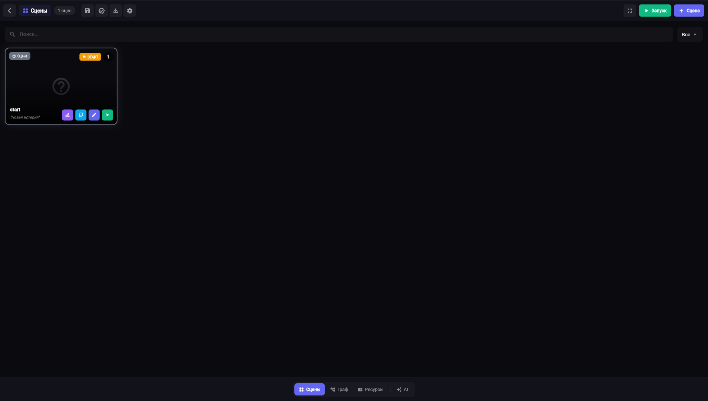

# Создание проекта

## Откройте папку
Ваш проект будет храниться локально (т.е., на вашем компьютере). Поэтому вам необходимо выбрать папку, где будут создавться архивы проектов, которые вы создадите (в которых будут храниться картинки персонажей, сценарные файлы и многое другое для каждого из проектов).

Нажмите на кнопку "Открыть папку", чтобы вызвать окно выбора.

Когда вы выберете папку, вам будет необходимо дать разрешение браузеру на чтение и редактирование файлов из этой папки. Для этого нажмите "Ок" или "Разрешить" в диалоговом окне.

Учтите, что иногда браузер будет отзывать разрешение на доступ редактора к папке с проектами (особенно, если долго его не использовать). В таком случае, он будет повторно спрашивать разрешения, и необходимо будет вновь подтверждать ваше согласие.

> Кстати, после того, как вы выберете папку, в списке "Мои проекты" автоматически появится демо-проект, который мы предоставляем как песочницу для тестирования фичей редактора при его изучении. Обязательно посмотрите, когда пройдете этот туториал!

## Добавьте новый проект
Нажмите на кнопку "+ Новый", чтобы создать проект.

В открывшемся окне необходимо ввести название проекта. Также, вы можете дополнительно указать автора проекта - свой никнейм или название команды.

Затем нажмите зеленую кнопку "Создать". Вы увидите нечто наподобие этого:

Это значит, что в вашей папке был успешно создан пустой проект, и вы можете приступить к разработке первой новеллы!
Давайте поверхностно осмотрим редактор - [какие базовые вкладки здесь есть, и для чего они нужны](./editor-overview.md).