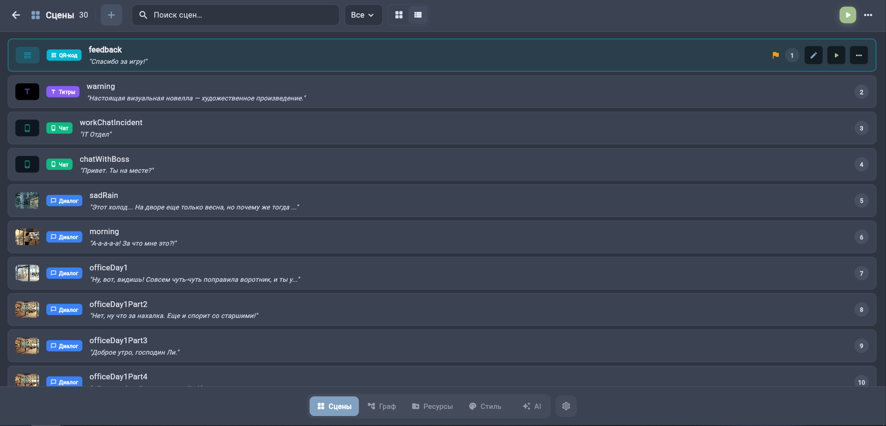
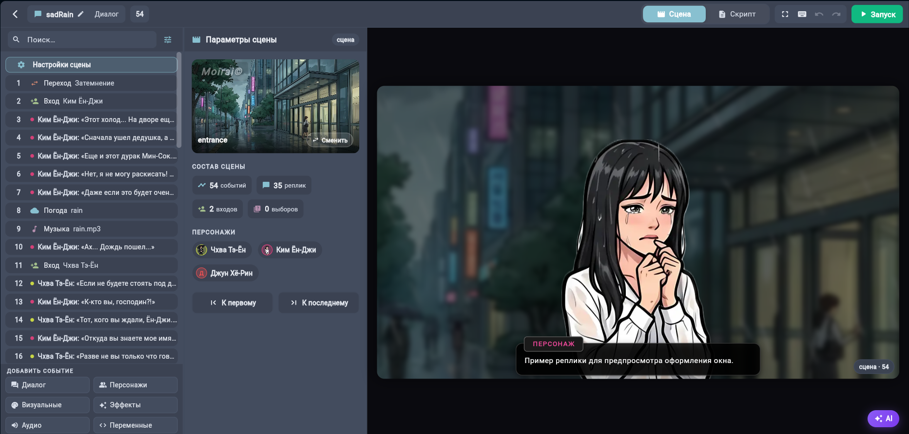
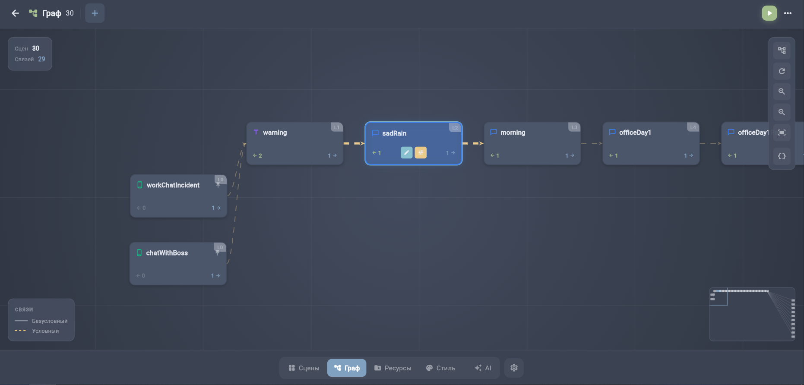
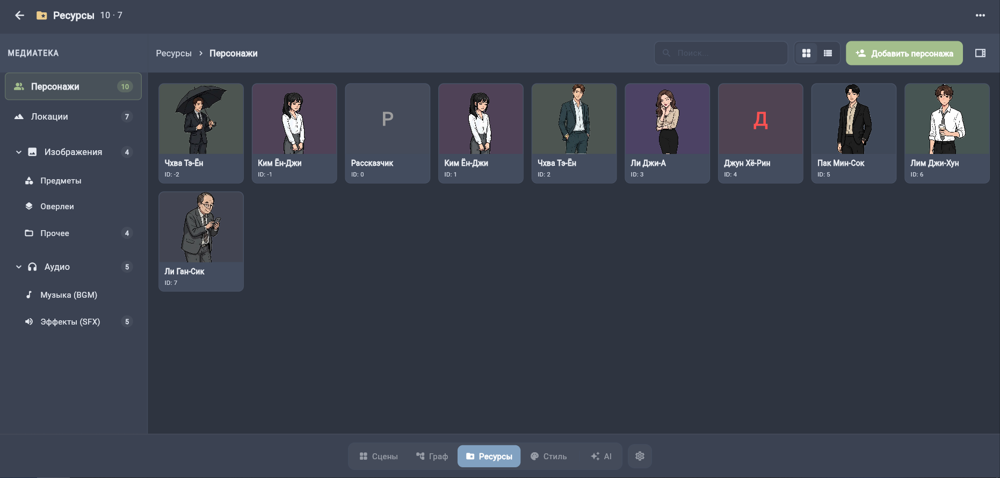
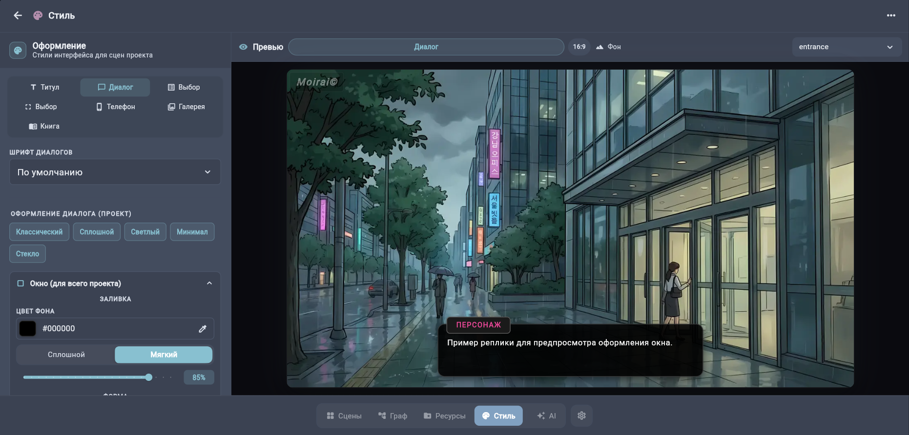

# Обзор редактора

После открытия проекта вы попадете в рабочее пространство VN Studio. Здесь создают сцены, добавляют ресурсы, связывают историю в граф и проверяют результат в плеере.

## Как устроена работа

История собирается из трех связанных частей:

- **Ресурсы** - персонажи, локации, изображения, музыка и звуковые эффекты.
- **Сцены** - отдельные фрагменты истории: диалоги, телефонные интерфейсы, мини-игры, титры и другие форматы.
- **Граф** - связи между сценами, порядок их запуска и условия переходов.

Обычно работа над историей выглядит так:

1. Подготовить персонажей, локации, изображения и звук в разделе **Ресурсы**.
2. Создать сцены в разделе **Сцены**.
3. Настроить содержимое сцен: реплики, действия, эффекты и переходы.
4. Связать сцены в разделе **Граф**.
5. Сохранить проект и запустить сцену или всю историю для проверки.

Не обязательно выполнять шаги строго по порядку. Например, можно сначала набросать структуру в графе, а затем наполнить сцены содержимым.

## Основные разделы

Нижняя панель навигации проекта открывает основные инструменты Studio.

| Раздел | Для чего нужен |
| --- | --- |
| **Сцены** | Создание, поиск и редактирование сцен истории. |
| **Граф** | Просмотр структуры истории, стартовой сцены, переходов и условий. |
| **Ресурсы** | Работа с персонажами, локациями, изображениями, музыкой и звуками. |
| **Перевод** | Раздел для работы с переводом проекта. |
| **Стиль** | Настройка визуального оформления истории и отдельных интерфейсных элементов. |
| **AI** | Раздел инструментов AI. |

## Сцены

Раздел **Сцены** содержит список всех сцен проекта. Здесь можно создать новую сцену, найти существующую, открыть ее для редактирования, переименовать, удалить или назначить стартовой.

У каждой сцены есть технический ID, который Studio использует внутри проекта. В обычной работе ориентируйтесь на название сцены: оно может быть написано на русском, китайском или любом другом языке.

Внутри редактора сцены находятся ее настройки, содержимое и панель свойств. Набор инструментов зависит от типа сцены: у диалога это события и персонажи, у телефонной сцены - контакты, сообщения или посты, у мини-игры - правила победы и сложность.

Во время работы со сценой вы можете:

- добавлять, редактировать, перемещать и удалять события;
- открывать настройки сцены;
- показывать или скрывать панель свойств;
- запускать сцену для быстрой проверки;
- вернуться к списку сцен и открыть другую сцену.

## Граф

Раздел **Граф** показывает, как сцены связаны между собой. Он помогает увидеть историю целиком и найти ошибки в ее структуре.

Граф помогает проверить:

- какая сцена назначена стартовой;
- куда ведет каждая сцена;
- где история разветвляется;
- какие переходы зависят от переменных;
- не появились ли тупики или недостижимые сцены.

Связь без условий используется как обычный переход. Условная связь срабатывает только тогда, когда состояние переменных соответствует заданному условию.

## Ресурсы

В разделе **Ресурсы** хранятся материалы, которые используются в истории:

- персонажи и их эмоции;
- локации и фоновые изображения;
- музыка;
- звуковые эффекты;
- изображения для сцен, интерфейсов и специальных форматов.

Сначала добавьте ресурс в проект, затем выберите его в настройках сцены или события. Например, локация используется как фон диалоговой сцены, а музыкальный файл выбирается в событии фоновой музыки.

## Стиль

Раздел **Стиль** отвечает за визуальное оформление истории. Здесь настраиваются темы и элементы интерфейса, которые повторяются в разных сценах: диалоговые окна, выборы, телефонные интерфейсы, титры, книги, галереи и другие форматы.

Лучше настроить общий стиль в начале проекта, а затем уточнять его по мере появления сцен. Это помогает сохранить единый вид истории.

## Сохранение и запуск

Сохраняйте проект после заметных изменений кнопкой **Сохранить** или сочетанием `Ctrl+S`.

Для проверки используйте:

- **Запустить сцену** - чтобы проверить открытую сцену;
- **Запустить историю** - чтобы пройти историю от стартовой сцены;
- **Проверить целостность** - чтобы найти незаполненные или некорректные данные перед запуском или экспортом.

Проверяйте историю не только по отдельным сценам. После изменения графа, переменных или переходов запускайте маршрут от начала и проходите его как игрок.

## Импорт и экспорт

В меню проекта доступны действия с его файлами:

- сохранить проект;
- экспортировать `.vnproject`;
- скачать ZIP-архив;
- проверить целостность;
- открыть настройки редактора.

Экспорт используйте для резервных копий, передачи проекта другому участнику команды и переноса на другое устройство.

Далее: [персонажи и сцены](3_characters-and-scenes.md).
