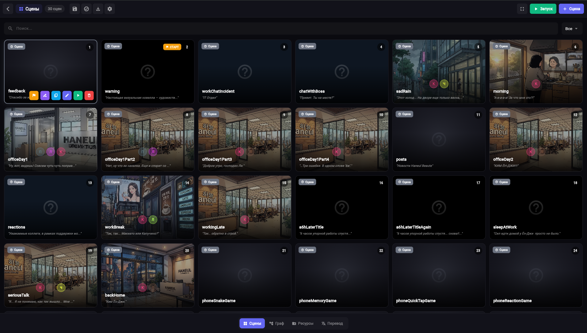

# Обзор редактора

## Логика редактора
Начнем с базовой организации редактора. Чтобы вам было удобнее работать, мы организовали новеллы так же, как они представляются в голове - маленькие детали постепенно соединяются в более крупные. Иерархия очень похожа на театральный спектакль:

- **Ассеты**: *персонажи и их эмоции, локации, саундтреки*. Аналогично актерам и декорациям, они готовятся заранее, а затем расставляются на подмостках в соответствии с требованиями сцены, где их используют. 
- **Сцены**: *диалоги, карты, мини-игры, катсцены*. Как режиссер, вы выбираете ассеты, которые будут участвовать в сцене, и задаете порядок событий, которые будут происходить: произношение реплик, перемещение ассетов и многое другое. Конечно, поскольку сцены многообразны, некоторые из них несколько отличаются от этой логики. Но в рамках этого туториала это не имеет значения.
- **История**. После того, как вы закончили работу со сценами, необходимо объединить их в единый сюжет - объяснить редактору, в каком порядке их воспроизводить, и где история должна разветвляться.

Как видите, логика достаточно интуитивна. Теперь рассмотрим, как она переносится в интерфейс редактора.

## Пользовательский интерфейс Moirai Editor

1. **Панель вкладок**. В зависимости от вашего выбора в настройках редактора, здесь может быть больше вкладок, или же они просто могут быть другими. Вот основные вкладки:
    - **Сцены** - открывает список всех сцен проекта
    - **Граф** - позволяет задавать порядок сцен в новелле и ветвление сюжета
    - **Ресурсы** - управление ассетами проекта: персонажами, фонами, музыкой и т.п.
    - **Перевод** - удобный инструмент для перевода всех текстовых строк, имеющихся в новелле, на любое количество языков
2. **Сохранение проекта**.
3. **Проверка целостности проекта**. Пока что редактор не имеет всех функций защиты от неправильных действий, поэтому, если вы наткнетесь на ошибку при воспроизведении - попробуйте поискать недочет с помощью этого инструмента.
4. **Экспорт .vnproject** - возможность экспортировать проект как один архив, чтобы его на другое ваше устройство или отправить его в техподдержку для уточнения баг-репорта.
5. **Настройки редактора**. Здесь вы можете выбрать фичи, которые вы хотите иметь в редакторе перед глазами. Также, здесь можно подключить экспериментальные элементы
6. **Включение полноэкранного режима** (если в работаете в браузере, а не в установленном PWA)
7. **Запуск всей новеллы внутри редактора**
8. **Добавление новой сцены**.

Этого базового знакомства достаточно, чтобы приступить к созданию новеллы. Далее, вы научитесь [добавлять персонажей и фоновые локации](./characters-and-scenes.md).
