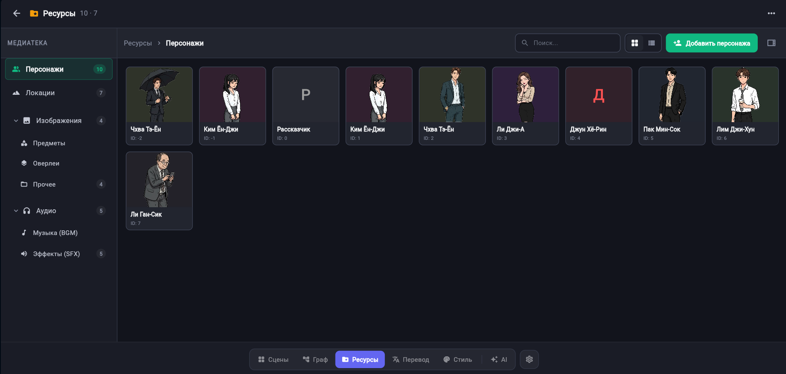
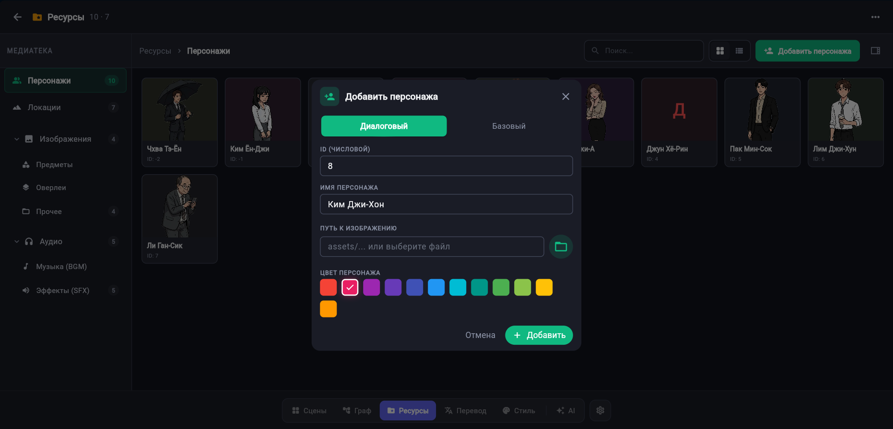
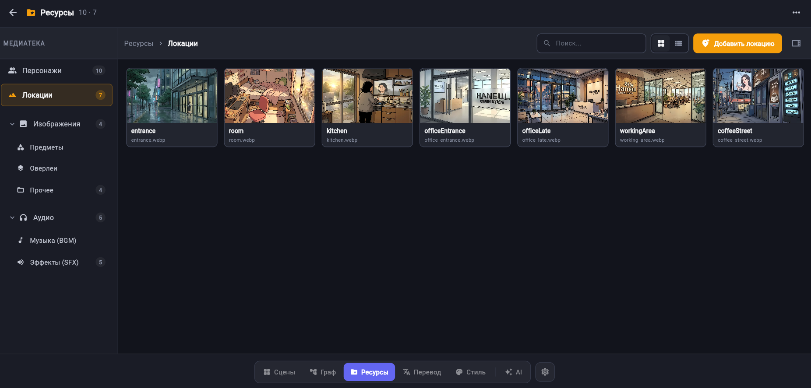
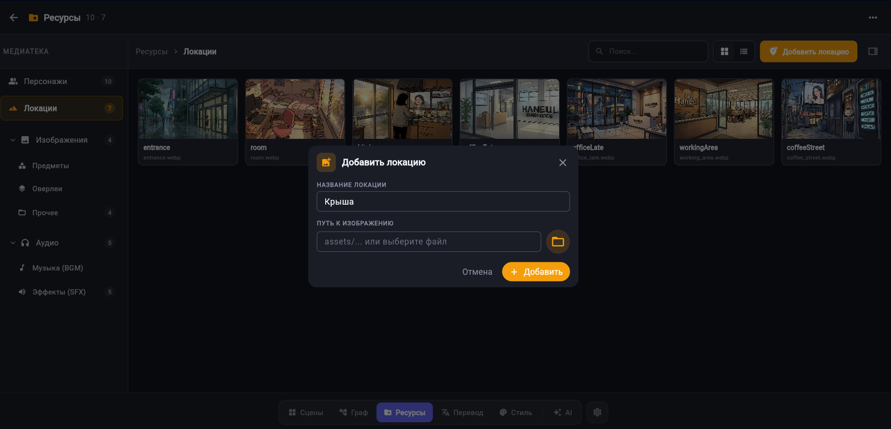

# Персонажи и локации

Персонажи и локации создаются в разделе **Ресурсы**. Подготовьте их до начала работы над диалогами: тогда при создании сцены вы сразу сможете выбрать фон, а в событиях - нужных героев и эмоции.

## Персонажи

Откройте **Ресурсы** и перейдите в раздел персонажей.

Нажмите **Добавить**, затем заполните карточку персонажа.

Для начала достаточно указать имя персонажа, изображение по умолчанию и несколько эмоций с соответствующими изображениями.

Имя - это авторское название персонажа, которое вы видите в Studio. Оно может быть написано на русском, китайском или любом другом языке: `Ким Ён-Джи`, `Главный герой`, `李明`.

Технический ID Studio создаёт и использует самостоятельно. Не стройте рабочий процесс вокруг ID и не меняйте его без необходимости.

### Эмоции

Эмоция определяет, какое изображение персонажа появится в сцене. Для одного героя можно подготовить обычное состояние, радость, грусть, злость, смущение и другие варианты.

Называйте эмоции понятно для команды и используйте одинаковые названия во всех сценах. Их также можно писать на любом языке.

### Характеристики персонажа

В карточке персонажа можно сохранить сведения, которые помогают держать образ героя цельным:

- **Явная цель** - чего персонаж хочет добиться осознанно.
- **Истинная цель** - что ему на самом деле нужно, даже если он этого не понимает.
- **Недостатки** - черты, которые мешают персонажу.
- **Тайны** - то, что персонаж скрывает.
- **Сокровища** - сильные стороны или особые умения.
- **Отношения** - заметки о связи с другими персонажами.
- **Голос** - особенности речи персонажа.

Эти поля помогают сценаристу и команде не потерять важные детали при работе над длинной историей. Они не заменяют сценарий и не создают ветвления автоматически.

## Локации

Локация хранит название и фоновое изображение, которое будет использоваться в сценах.

Откройте **Ресурсы**, перейдите в раздел локаций и нажмите **Добавить**.

Укажите название локации и выберите изображение фона.

Для локаций тоже можно использовать названия на любом языке: `Квартира`, `Вход в офис`, `Кофейная улица`.

> У локации должно быть фоновое медиа. Если изображения нет, Studio предупредит об этом и предложит использовать фон-заполнитель. Для готовой истории лучше заменить его настоящим фоном.

## Как использовать ресурсы в сцене

После создания ресурсов их можно выбирать в настройках сцены и событиях.

- Локация задаёт фон диалоговой сцены.
- Персонаж появляется через событие **Вход персонажа**.
- Эмоция выбирается в реплике или при смене состояния персонажа.
- Музыка и звуки добавляются отдельными событиями.

Не удаляйте персонажа, локацию или изображение, пока не убедитесь, что они не используются в сценах. После удаления ссылки в истории могут стать некорректными.

Далее: [диалоговая сцена](4_dialogue-scene.md).
