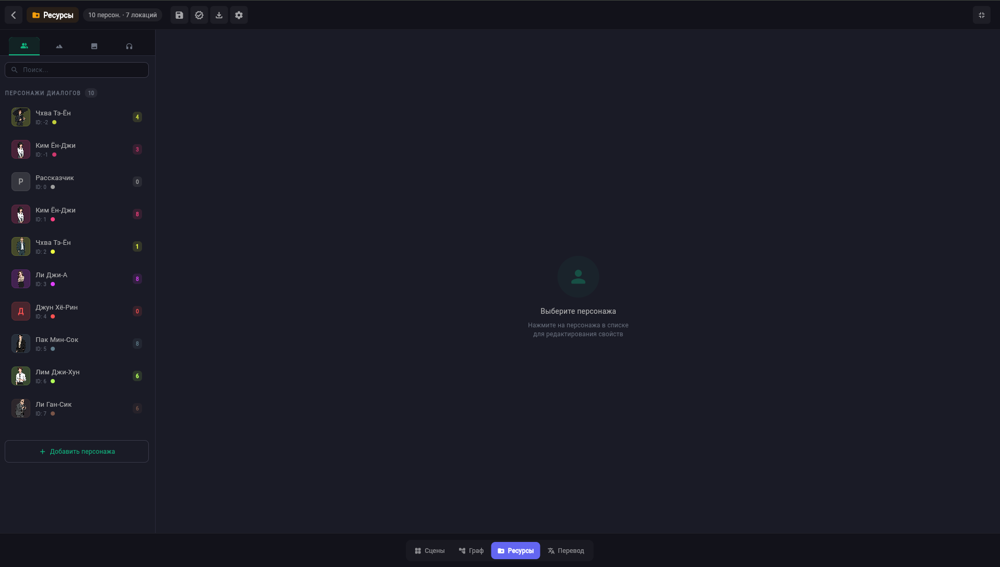
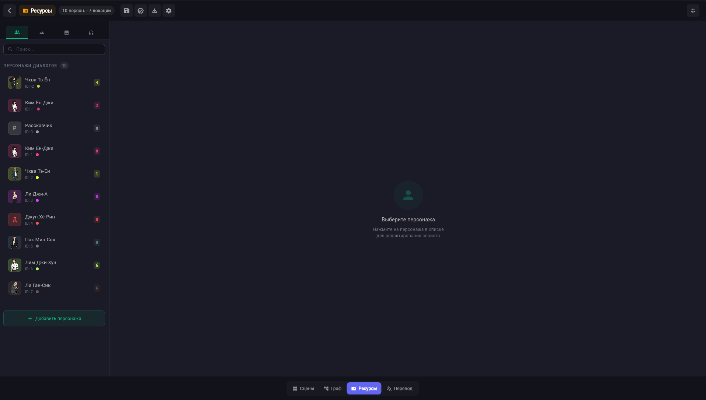
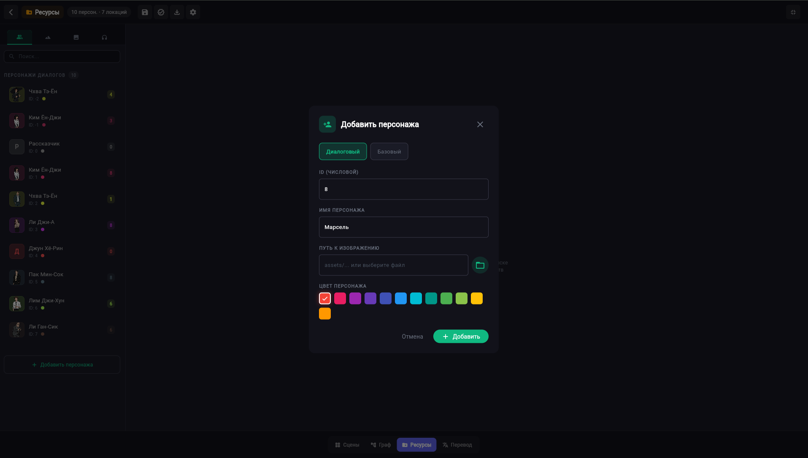
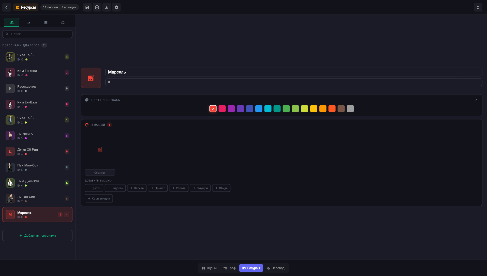
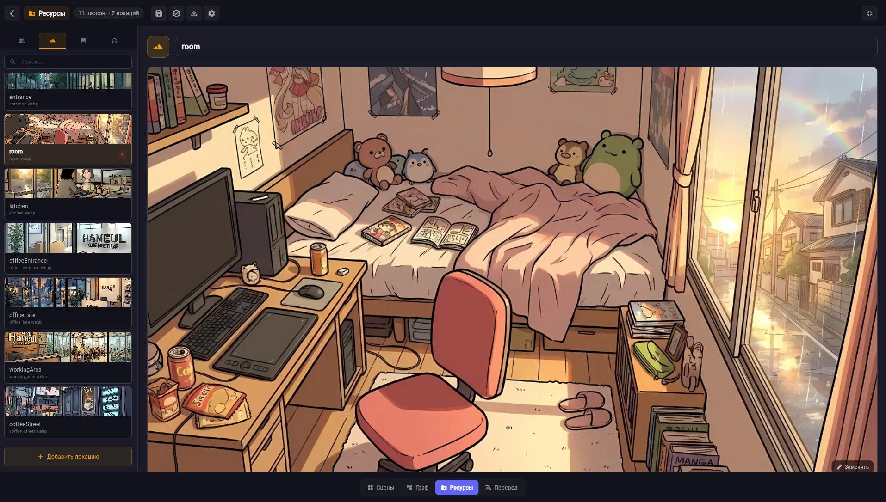
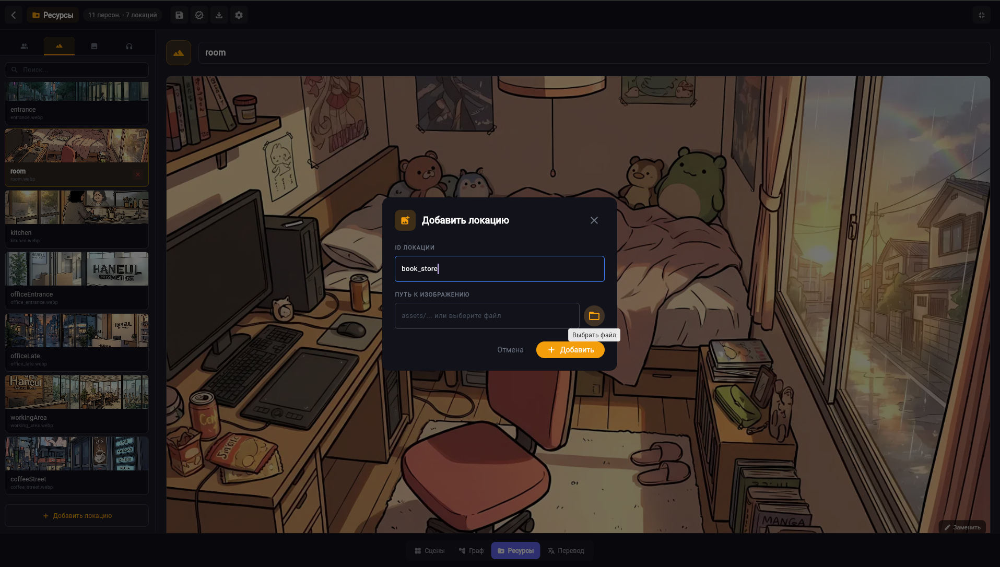

# Персонажи и сцены

Для продолжения туториала, вам потребуется графика, которую вы сможете импортировать в проект. Если у вас уже есть свои изображения персонажей и фонов - это чудесно. Если нет, то вы можете использовать бесплатный [ассетпак от команды Moirai](https://drive.google.com/drive/folders/1JiV9TtUdG6BKx7ZpbVAk2dQuoF8OfHoK?usp=sharing). Просто скачайте архив по ссылке, распакуйте его, и вы сможете повторить все дальнейшие шаги из туториала.

## Добавление персонажа в проект

1. Перейдите во вкладку "Ресурсы"
2. По умолчанию, в этой вкладке открыт раздел "Персонажи". Если нет, откройте его, как на картинке

    

3. Нажмите на кнопку добавить персонажа

    

4. Заполните базовую информацию о персонаже
    - ID проставляется автоматически. Вы можете его поменять, но лучше не стоит
    - Укажите его имя
    - Выберите путь к иконке. Она будет использоваться рядом с именем пресонажа при отображении в некоторых меню. Также, она по умолчанию добавляется как нейтральная эмоция. Некоторые предпочитают не добавлять иконку, потому что нейтральную эмоцию можно задать позже, а в меню дефолтная первая буква имени читается легче, чем сжатый портрет
    - Задайте цвет персонажа. Именно этим цветом имя персонажа будет отрисовываться в различных сценах и интерфейсах.

    
6. Подтвердите создание персонажа нажав кнопку "+ Добавить"
7. Заполните эмоции персонажа - для этого либо нажмите на один из предлагаемых вариантов эмоций (грусть, радость и т.п.) [1], либо нажмите кнопку "+ своя эмоция" [2], заполните ее название. После этих действий откроется окно файловой системы, в котором вы должны указать соответствующую картинку персонажа с нужной эмоцией. Кстати, даже после создания эмоции в можете менять их изображения - достаточно кликнуть во карточке эмоции [3]

    

Добавьте вашему персонажу пару-тройку эмоций - и он готов к активному участию в диалогах!

## Добавление фоновой локации в проект

Работа с локациями - еще проще, чем с персонажами (но только пока мы не добавили "продвинутые локации" с анимациями и интерактивными элементами).

1. Перейдите во вкладку "Ресурсы"
2. Перейдите в раздел "Локации"
3. Нажмите кнопку "+ Добавить локацию"
4. Заполните информацию о локации во всплывшем окне, и выберите фоновую картинку. Рекомендуемое соотношение сторон - 16:9
5. Нажмите кнопку "+ добавить"

    

Локация готова! Теперь, когда вы умеете создавать саамые базовые локации, вы можете наконец-то [создать свою превую сцену - диалог](./dialogue-scene.md)!