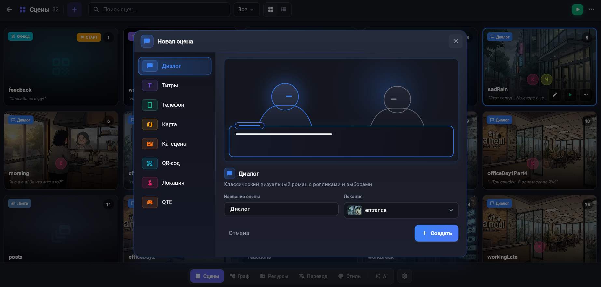
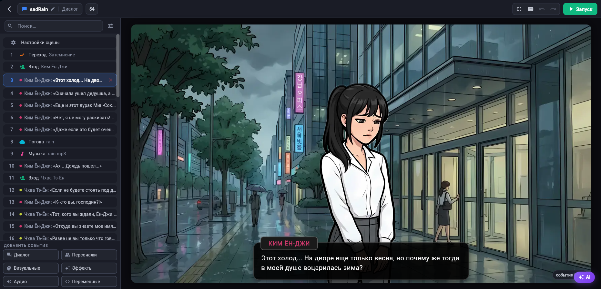
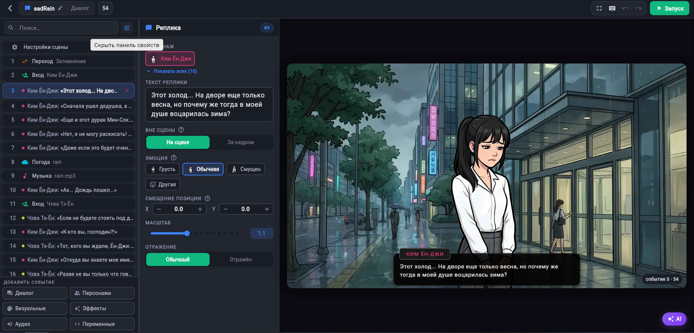

# Диалоговая сцена

Диалоговая сцена нужна для реплик, персонажей в кадре, музыки, визуальных эффектов и решений игрока. События выполняются сверху вниз, поэтому их порядок определяет то, что увидит игрок.

## Создайте сцену

1. Откройте раздел **Сценарии**.
2. Нажмите **Создать сцену**.
3. Выберите тип **Диалог**.
4. Введите понятное название и подтвердите создание.

Технический ID Studio создаёт сама. Для работы ориентируйтесь на название сцены: оно может быть написано на русском, китайском или любом другом языке.

## Как устроен редактор

Слева находится **список событий** в порядке их выполнения; здесь же можно открыть **Настройки сцены**. Основную часть экрана занимает предпросмотр сцены.

Когда вы выбираете событие, открывается панель его свойств. Она располагается рядом с предпросмотром, поэтому во время настройки можно сразу видеть результат. Панель свойств можно скрыть и снова показать кнопкой рядом с поиском вверху списка событий.

Внизу списка расположены категории для добавления нового события: **Диалог**, **Персонажи**, **Визуальные**, **Эффекты**, **Аудио** и **Переменные**. Выберите категорию, затем нужное действие. Добавленное событие появится в списке; его можно выбрать и настроить справа.

## События диалога

В категории **Диалог** доступны:

- **Реплика** -- текст персонажа или рассказчика;
- **Выбор (текст)** -- выбор варианта формулировки;
- **Выбор (действие)** -- выбор действия игрока;
- **Ввод текста** -- поле для ответа игрока;
- **Заметка по сцене** -- авторская пометка внутри сценария.

Чтобы добавить обычный текст, выберите **Диалог** -> **Реплика**. В её настройках укажите персонажа и текст. Для реплики также доступны параметры подачи:

- **Вне сцены** -- текст показывается как реплика за кадром;
- **Эмоция** -- выражение персонажа во время реплики;
- **Смещение позиции** -- положение портрета по осям X и Y;
- **Масштаб** -- размер портрета;
- **Отражение** -- обычное или зеркальное отображение.

Настройте реплику после того, как добавили персонажа в проект и создали для него нужные эмоции.

## Персонажи

Категория **Персонажи** управляет героями в кадре:

- **Вход**;
- **Выход**;
- **Фокус**;
- **Сброс фокуса**.

## Визуальные события

В категории **Визуальные** настраивается основная картинка сцены:

- **Смена фона**;
- **Переход**;
- **Зум** и **Сброс зума**;
- **Показать CG** и **Скрыть CG**;
- **Фильтр** и **Убрать фильтр**.

## Эффекты

Категория **Эффекты** содержит дополнительные эффекты поверх сцены:

- **Оверлей** и **Скрыть оверлей**;
- **Погода** и **Убрать погоду**;
- **Тряска**.

## Аудио

В категории **Аудио** доступны **Фон. музыка**, **Стоп музыка** и **Звук. эффект**. Подробнее о настройке файлов и событий -- в разделе [Музыка](5_music.md).

## Переменные

В категории **Переменные** можно:

- **Установить** значение;
- **Изменить** значение;
- добавить **Ветвление**;
- **Выдать предмет** или **Забрать предмет**;
- использовать событие **Время**.

Например, для начала эпизода можно сначала добавить переход, затем вход персонажа, реплику и музыку. Чтобы изменить порядок, переместите событие в списке до проверки сцены.

## Проверьте сцену

Сохраните проект через `Ctrl+S` или меню проекта, затем нажмите **Запуск** в правом верхнем углу. Проверьте порядок событий, отображение персонажей, текст, звук и реакции на выборы.

Когда эпизод готов, откройте **Граф** и свяжите эту сцену с предыдущей и следующей. Без связи на графе игрок не попадёт в сцену при запуске всей истории.

Далее: [Музыка](5_music.md), [Граф истории](6_story-graph.md) и [Добавляем ветвление](7_branching.md).
