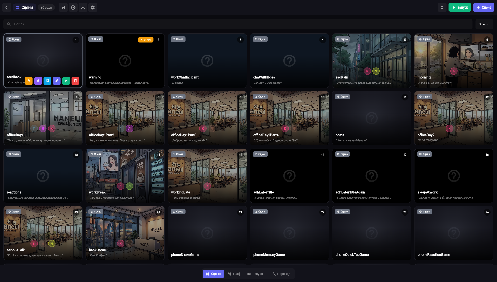
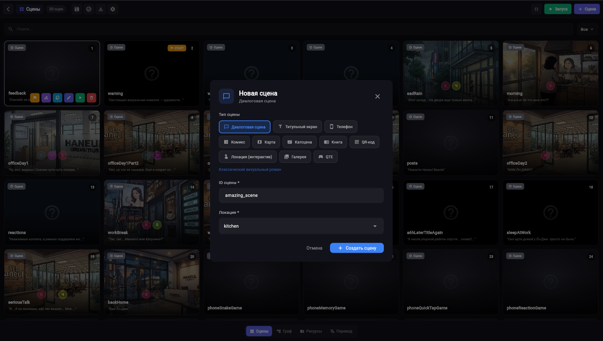
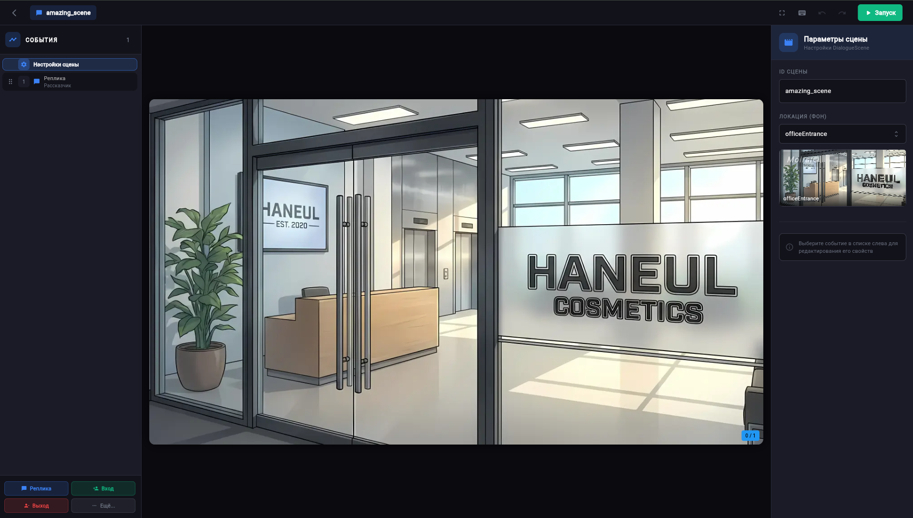

# Диалоговая сцена

Самая интересная и полезная часть Moirai - это редакторы сцен. И в ВН самый важный тип сцен - это, конечно, диалоги. Познакомимся с ней поближе.

Прежде всего, вам нужно открыть вкладку "Сцены" и создать новую сцену-диалог, кликнув на синюю кнопку "+ Сцена" в правом верхнем углу.



Во всплывающем окне:
1. Выберите тип "Диалоговая сцена"
2. Укажите ее название (только английские буквы, цифры и _)
3. Выберите фоновую локацию - одну из тех, что вы создали на прошлом этапе.
4. Завершите настройку сцены нажав кнопку "+ Создать сцену"



Новая сцена появится в списке сцен проекта. Кликните по ней дважды, чтобы открыть редактор диалога. Он выглядит следующим образом:



Если вас не устраивает фоновая локация, которую вы установили диалогу при создании сцены, вы всегда можете поменять ее, нажав кнопку "Настройки сцены" в панели события.

## Логика работы диалога

Большинство сцен в новелле работают по общей логике (и диалоги - не исключение):

- Сценарист добавляет в сцену события и располагает их в определенной последовательности. В обычном сценарии это могло бы выглядеть так:
    ```md
    1. Ольга вошла.
    2. Ольга сказала: Доброе утро!
    3. Ольга отошла левее.
    4. Славик вошел.
    5. Славик встал справа от Ольги.
    6. Камера надвинулась на Славика.
    7. Славик подумал: Где я?!
    ```
- Когда игрок запустит вашу новеллу и у него откроется эта диалоговая сцена, то по каждому его клику будет воспроизводиться следующий ивент (событие).

Следовательно, при создании диалога ваша работа будет сводиться к трем действиям:
- Выбор и добавление необходимых ивентов для создания нарратива
- Перемещение ивента на подходящее для него место в порядке ивентов
- Настройка содержимого ивента под ваш сценарий.

## UI редактора диалога и добавление ивентов


Интерфейс редактора состоит из следующих элементов:
- В колонке слева находятся два ключевых элемента:
    1. Колонка с событиями сцены, определяющая порядок их воспроизведения
    2. Кнопки добавления ивентов: 3 для быстрого доступа к наиболее распространенным - "Вход", "Выход", "Реплика", и одна, открывающая список всех ивентов, доступных в диалоге.
- По центру - крупное превью, которое отображает ивент, который выбран в колонке слева (выбранный элемент выделяется более ярким синим)
- В колонке справа располагаются параметры ивента

## Ключевые ивенты

Рассмотрим наиболее полезные на первом этапе ивенты:

- `Вход (персонажа)` - анимированное добавление персонажа в сцену. Вы можете настроить его направление входа, и позицию, на которую он встанет. Настоятельно не рекомендуем менять позицию, не прочитав соответствующий раздел в более подробной документации раздела "Редактор Moirai". Персонажей необходимо добавлять, чтобы они корректно отрисовывались внутри сцены во время их реплик.
- `Выход (персонажа)` - анимированное удаление персонажа из сцены.
- `Реплика` - самый важный элемент новеллы. Выберите персонажа из доступного списка, напишите текст его реплики и подберите подходящую картинку эмоции из тех, что вы добавили при создании персонажа.
- `Фокус` \ `Сброс фокуса` - позволяет выделить одного персонажа на сцене, размыв и затемнив фон и остальных персонажей. Полезно, если вы хотите добавить внутренний монолог.

Moirai предоставляет еще много полезных ивентов, и их список будет расширяться по мере получения фидбека от разработчиков новелл, использующих наш движок. Тем не менее, этих четырех достаточно для начала. Попробуйте собрать из них свой диалог!

---

Если вы уже собрали диалог, и он кажется вам простым - не переживайте! Дальше в туториале вы изучите еще несколько ивентов, которые сделают вашу первую новеллу существенно интересней.

## Тестирование диалога

Помимо просмотра сцены в превью по центру экрана, вы можете выполнить полноценную сборку и посмотреть сцену непосредственно в том виде, в каком ее увидят игроки. Для этого необходимо нажать на кнопку запуск в правом верхнем углу.

Далее - [как добавить музыку и SFX](5_music.md)