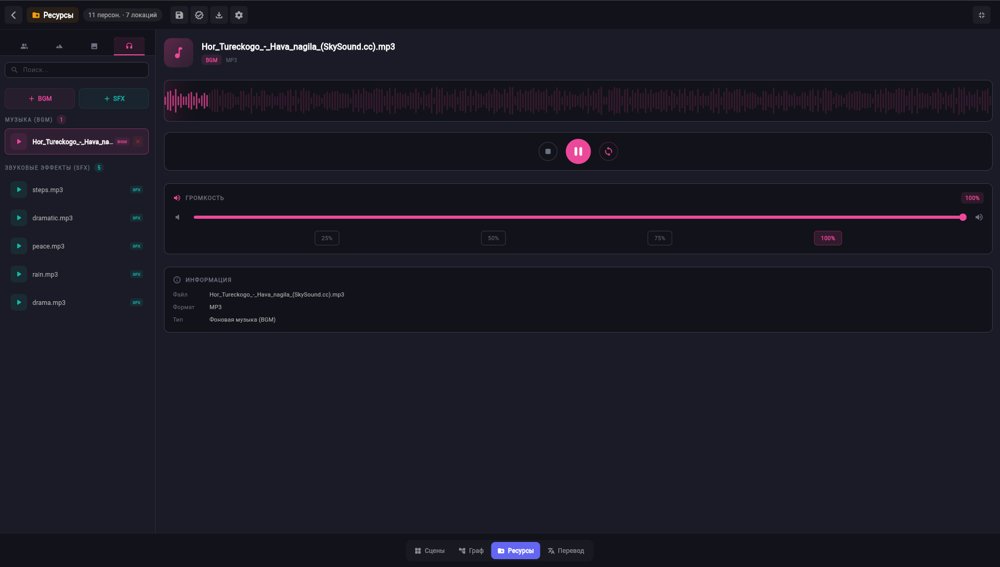
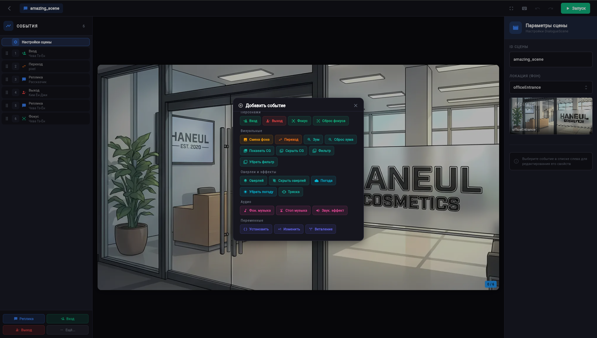

# Музыка

Поддержка воспроизведения музыки появилась в Moirai сравнительно недавно, и мы продолжаем развивать движок и редактор в этом направлении.

Надеемся, что для разработки вашего первого проекта вам хватит этого функционала!

## Добавление аудио в новеллу

Музыка и SFX добавляется в проект также, как и персонажи или локации: во вкладке "Ресурсы" нужно открыть раздел "Аудио".

Две кнопки предлагают вам добавить один из двух вариантов:
- `BGM (Background Music)` - фоновая музыка, которая может воспроизводиться по умолчанию или же по вашему запросу через ивент в некоторой сцене. 
- `SFX (Sound Effects)` - короткий звук, который используется для разового воспроизведения (например, скрип двери, шаги или удар во время боя). 

В этом туториале, остановимся на `BGM`. В параметрах трека можно настроить его громкость (чтобы выровнять с остальными треками в новелле).

## Включение фоновой музыки в диалоге

В меню выбора типа нового ивента необходимо выбрать `Фон. Музыка` из категории "Аудио". Обратите внимание, что для него существует и парный ивент - `Стоп музыка`.

В параметрах ивента справа необходимо указать путь к музыкальному ассету (или же выбрать его из доступных через выпадающее меню.)

Теперь ваш диалог ощущается куда более ярко благодаря саундтреку! Далее, вы узнаете [как собрать несколько сцен в единую новеллу](./6_story-graph.md).