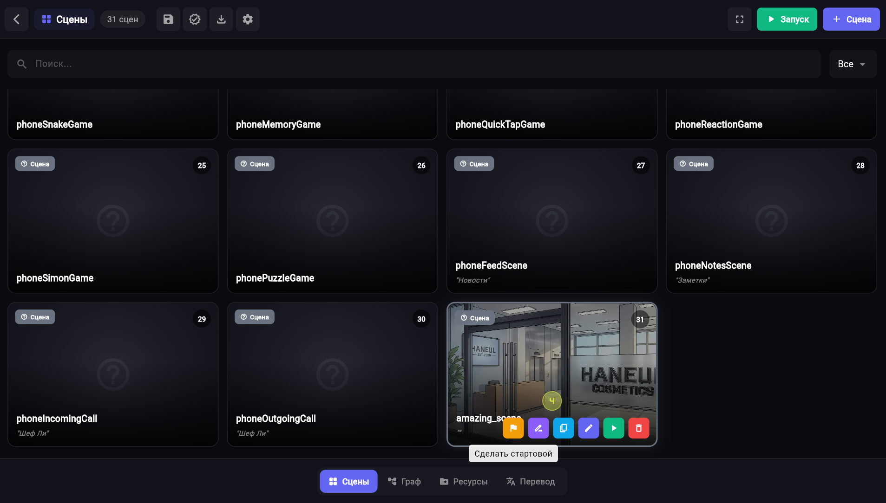
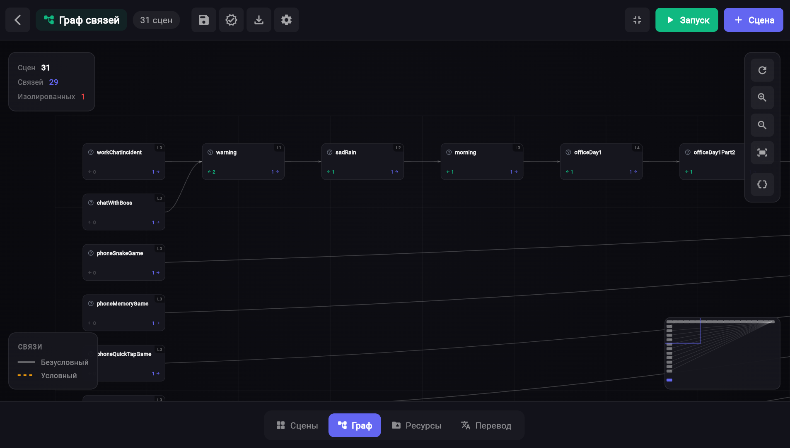
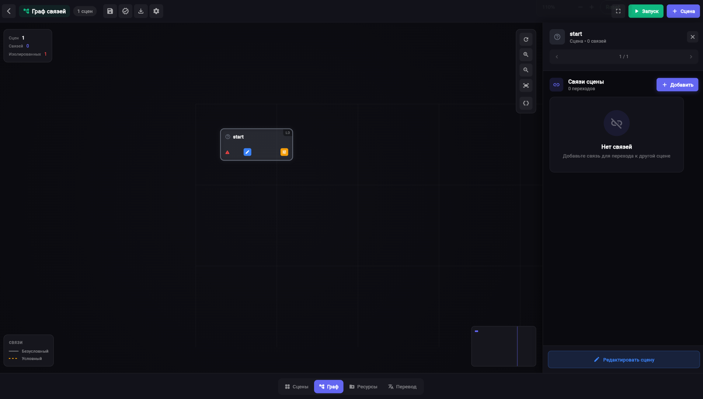
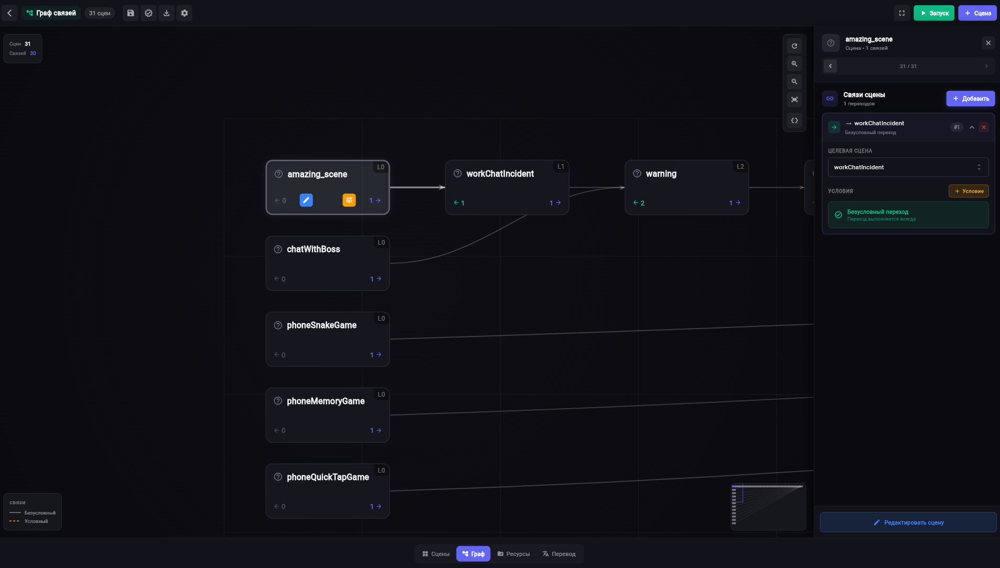

# Граф истории

Настало время соединить несколько отдельных сцен в единую историю. Начнем с простого варианта - кинетическая (линейная) новелла, не имеющая разветвления сюжета.

## Переход между сценами

1. Для начала создайте несколько диалоговых сцен, и заполните их какими-либо видимыми событиями - чтобы было что соединять
2. Затем назначьте одну из этих сцен стартовой в списке сцен. Для этого сначала кликните на сцену, а затем - на появившуюся кнопку "Сделать стартовой"
    
    

3. Перейдите во вкладку "Граф"
    
    

4. Выделите ту же сцену внутри графа, нажав на нее. На ноде сцены появится новая кнопка - связи. Нажмите на нее, чтобы открыть панель связей сцены
    
    
    
    Данные связи определяют, какую сцену движок должен запустить следующей последанной сцены. 
    - Если связь одна и не имеет условий, то будет запущена именно та сцена, к которой ведет единственная связь. 
    - Если связей несколько и у каждой есть свои условия перехода - движок будет поочередно проверять условия, пока одно из них не окажется верным. Тогда он перейдет к той сцене, на которую указывает успешно проверенная связь, игнорируя все остальные.

4. Добавьте одну связь к стартовой сцене, и выберите любую другую сцену на ваш вкус в параметре связи `Целевая Сцена`.
    

Далее, аналогичным образом соедините между собой остальные сцены вашей новеллы. 

> Не удивляйтесь, что при изменении связей между сценами меняется расположение сцен в графе. В отличие иных `Node-Based` систем (вроде `Blueprints` или `Intale`), наш граф создан не для ручного управления связями, а для корректного и своевременно обновляющегося отображения ветвления сценария новеллы. Поэтому, установление связей сейчас происходит через отдельную панель, а сам граф строится автоматически без вашего участия.

---

Поздравляем! Вы успешно закончили вашу первую новеллу! Для теста, вы можете запустить ее, нажав кнопку "Запуск" в правом верхнем углу.

В следующей главе вы сделаете новеллу еще интересней, добавив в нее возможность [выбора действий, а также ветвление сенария](./7_branching.md).