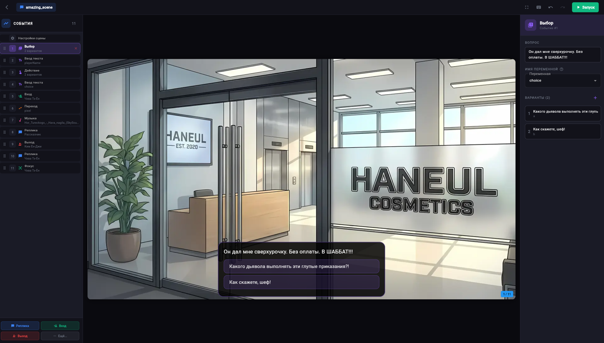
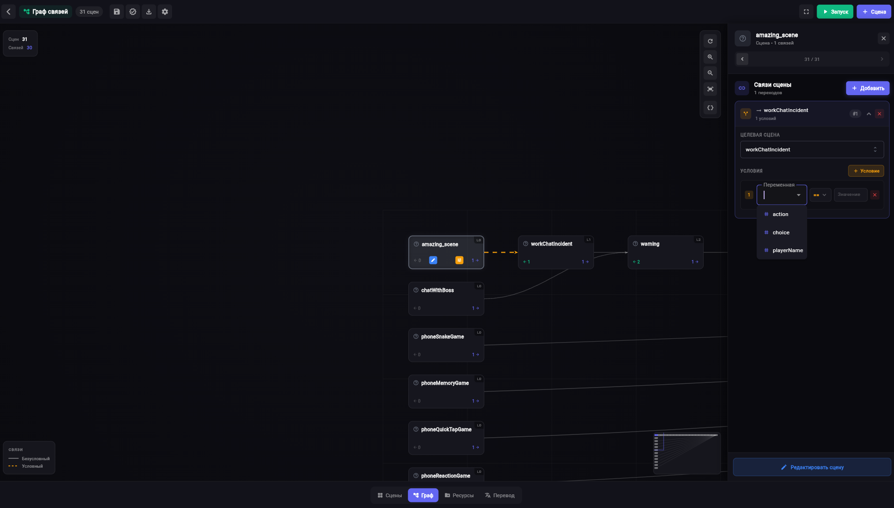
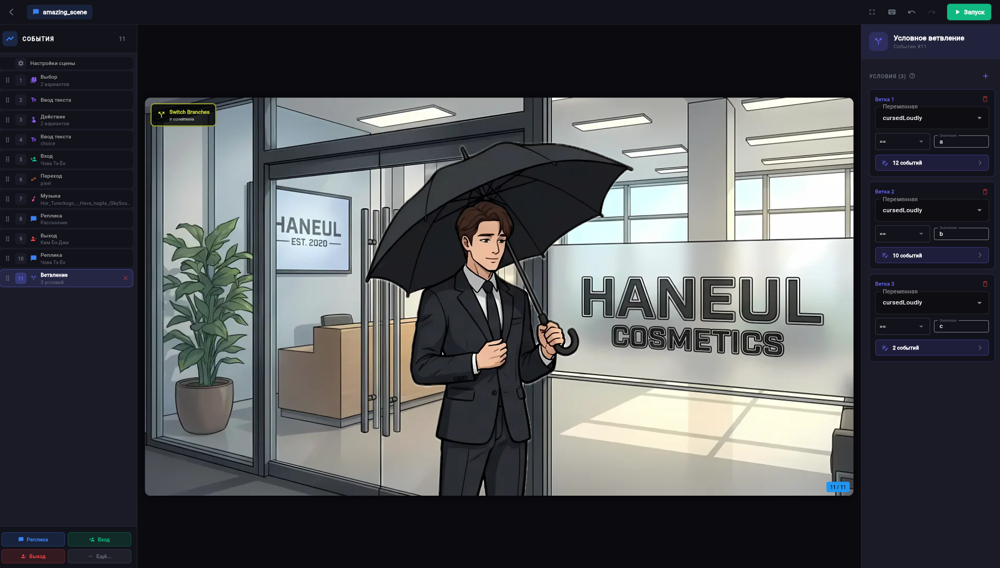

# Добавляем ветвление

Возможность выбора своих действий - ключевая особенность жанра визуальных новелл. Добавим ветвление сценария в вашу новеллу!

## Выбор и переменные

Для начала необходимо добавить непосредственно сам выбор, который игрок сможет совершать. 

Для этого существует множество способов в разных сценах. Остановимся на соответствующих ивентах диалога. Вы можете использовать:
- Выбор (текст) - для выбора игроком реплики его персонажа
- Выбор (действие) - для выбора игроком реплики его персонажа
- Ввод текста - для ввода игроком произвольной строки. Удобно для выбора игроком имен персонажей, или ввода паролей, добытых в игре

Следует отметить, что суть у этих ивентов на самом деле одна и та же: 
- они записывают некоторые данные (число, символьную строчку) в память новеллы, и дают этим данным имя;
- по этому имени вы позже сможете получить эти данные, и использовать их для проверки некоторого условия (например, при выборе следующей сцены, когда текущая завершится).

Это сочетание (данные + их имя в памяти новеллы) называется `Переменная`. Именно на переменных и строится ветвление сюжета любой новеллы.

Таким образом, при использовании трех перечисленных выше ивентов, вам необходимо заполнить 3 поля:
- `Имя переменной`, в которую выбор запишется. Это может быть строка из английских букв и цифр. Если раньше такой переменной не было, она будет создана, если нет - ее прошлое значение перезапишется. 
- `Варианты выбора` - каждый из которых содержит данные:
    - `Текст выбора` - то, как данный вариант будет отображен в новелле
    - `Значение переменной` - то, что будет вписано в переменную, если игрок выберет этот вариант. Это может быть строка из английских букв и цифр
- `Вопрос` - текст, который пояснит игроку, что он сейчас выбирает.

Настоятельно рекомендуем давать переменным и их значениям осмысленные названия. Например, `responseToHelensConfession` - это хорошее имя, а `var1` - обычно не очень (если только вы не храните отдельно табличку, в которой подробно описывается сюжетное значение каждой такой переменной)

## Ветвление в графе

Самое частое использование ветвлений - это влияние действий игрока на финал новеллы (т.е., на то, какие сцены в новелле будут запускаться по мере прогресса в игре).

Для этого вернемся в редактор графа сценария, и откроем связки сцены, в которую мы добавили события выбора.

> ❗ **БАГИ**

> Мы активно работаем над улучшением системы переменных. Но сейчас она пока что позволяет пользователям допускать ошибки: например, если вы сделаете проверку значения переменной на сцене, расположенной раньше сцены, где переменная создается - редактор вас не остановит, и это может привести к крэшу вашей новеллы у игрока.

> Тем не менее, на наш взгляд это не повод отказываться от разработки вашей новеллы или добавления в нее вариативности - только повод быть особенно внимательными при планировании ветвления.

> Система ветвления - наш приоритет в разработке редактора, и мы надеемся скоро сделать ее более удобной для вас и безопасной.

Для реализации ветвления сюжета нужно:
1. Нажать на кнопку "+ Условие"
2. В появившемся меню условия нужно выбрать в выпадающем меню имя существующей переменной и необходимое ее значение для перехода по данной связке
3. Добавьте еще произвольное количество "условных" связок 
4. В конце обязательно добавьте связку без условия - это будет "переход по умолчанию", который гарантирует, что если вы предусмотрели не все варианты условий связок, игра не прервется, и игрок пойдет дальше по сюжету.

---

Поздравляем! Теперь ваша игра полностью подходит под определение жанра визуальной новеллы!

## Ветвление внутри сцены

Играя в визуальные новеллы, авторы редактора и движка часто сталкивались с разочаровывающим фактом: во многих новеллах последствия действий бывают только глобальными (т.е., полное изменение развития событий, замещение целых сцен). Но вот большое количество мини-последствий (мгновенная реакция другого персонажа на выбор игрока, регулярное ворчание по этому поводу и т.п.) - это редкость!

Поэтому, мы хотели поощерить авторов новелл добавлять такие мини-последствия. Для этого мы добавили возможность ветвления внутри диалогов. По сути, это просто еще один ивент диалога - `Ветвление`, но внутри которого вы можете создавать **условные ветки** - такие же последовательности событий, как и сам диалог. 

Условия веток работают точно также, как и условия связок. Для каждой ветки вы создаете свою серию событий, и в ходе игры будет воспроизведена именно та ветка, условие которой первым оказалось удовлетворено состоянием памяти новеллы.

После того, как игрок пройдет по выбранной движком ветки, продолжат исполняться ивенты диалога, которые идут после ивента `Ветвление`.