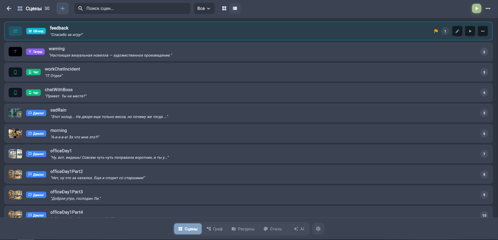

# Виды сцен

Сцена -- самостоятельный фрагмент истории. Она содержит данные своего типа и становится частью прохождения, когда вы добавляете её на [граф истории](../first-steps/6_story-graph.md). В списке и на графе используйте понятные названия сцен: внутренние идентификаторы Studio создаёт для технических задач.

Создать сцену можно в разделе **Сценарии**: нажмите **Создать сцену**, выберите тип, введите название и подтвердите создание. Тип определяет доступные события и рабочую область сцены; после создания сменить его нельзя, поэтому выберите формат до начала наполнения.

## Диалог

Основной тип для визуальной новеллы: реплики, персонажи в кадре, фон, музыка, выборы, переменные и переходы. Начинайте с него большинство сюжетных эпизодов.

Подробный разбор: [Диалоговая сцена](../first-steps/4_dialogue-scene.md).

## Титульная сцена

Показывает титульный экран или отдельную текстовую заставку. Подходит для названия главы, предупреждения, финального экрана или паузы между крупными частями истории.

## QR-код

Показывает QR-код, который игрок может отсканировать. Используйте сцену, когда в историю нужно встроить ссылку на внешний материал, социальную сеть или дополнительное задание.

## Экран телефона

Телефонные сцены имитируют приложения на устройстве персонажа. В зависимости от задачи выберите подходящий формат:

- **Чат** -- переписка и выбор сообщений;
- **Лента** -- публикации и прокрутка условной социальной сети;
- **Заметки** -- записи, списки и текстовые материалы;
- **Звонки** -- набор номера, входящий или исходящий вызов;
- **Игра** -- мини-игра внутри интерфейса телефона.

Такие сцены особенно полезны, когда нужно сменить привычный ритм диалога, но сохранить историю внутри интерфейса игрока.

## Комикс и вебтун

Сцена комикса показывает последовательность панелей. Она подходит для динамичного эпизода, монтажа, рассказа без реплик или вертикального чтения в стиле вебтуна.

## Карта

Интерактивная карта даёт игроку выбрать место или точку действия. Используйте её для исследования локаций, выбора маршрута или навигации между сюжетными узлами.

## Катсцена

Катсцена нужна для эпизода, в котором автор управляет подачей без действий игрока: например, для вступления, смены времени или короткой анимационной вставки.

## Книга

Сцена книги оформляет текст как страницы из дневника, письма, справочника или другого внутриигрового издания. Выбирайте её, когда оформление текста важно для восприятия.

## Галерея

Галерея показывает подборку изображений. Она подходит для просмотра CG, улик, фотографий, иллюстраций или уже открытых материалов.

## QTE

Quick Time Event предлагает игроку быстро выполнить действие. Используйте его точечно в напряжённых моментах: погонях, реакции на опасность или проверке внимательности.

## Как выбрать тип

Выбирайте сцену по действию игрока, а не только по визуальному оформлению:

- нужно читать реплики, принимать сюжетные решения или менять переменные -- **Диалог**;
- нужно показать отдельный экран или заголовок -- **Титульная сцена**;
- игрок взаимодействует с интерфейсом смартфона -- один из типов **Телефона**;
- игрок выбирает место -- **Карта**;
- важна последовательность иллюстраций или страниц -- **Комикс** либо **Книга**;
- нужна короткая реакция на время -- **QTE**.

Любая сцена становится частью истории только после связи на графе. После добавления нового узла запускайте историю целиком и проверяйте, что к нему можно прийти из стартовой сцены.
