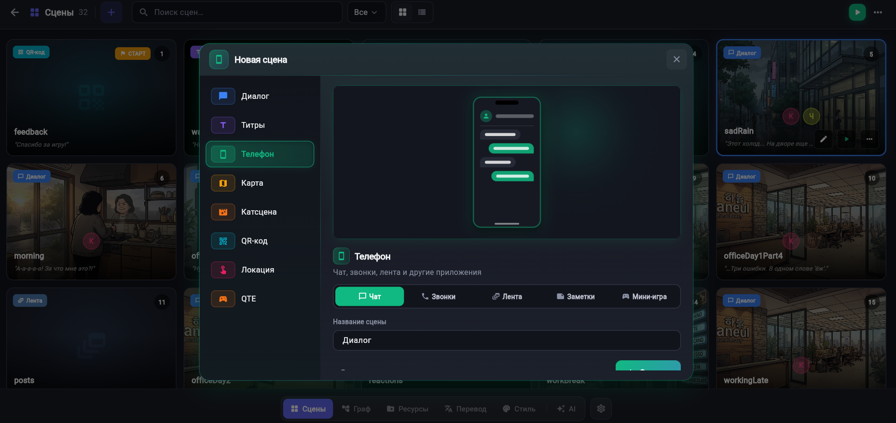
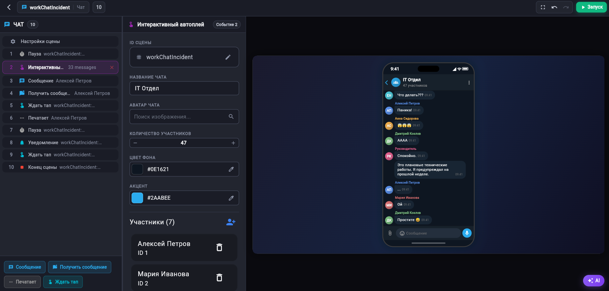

# Телефонный чат

Телефонный чат показывает переписку как экран мессенджера. Это отдельный тип сцены, а не вариант обычного диалога: события чата управляют появлением сообщений, паузами и действиями игрока внутри интерфейса телефона.

## Создание сцены

1. В разделе **Сценарии** нажмите **Создать сцену**.
2. Выберите тип **Телефон**, затем режим **Чат**.
3. Введите понятное название и создайте сцену.
4. Добавьте её на [граф истории](../../first-steps/6_story-graph.md), чтобы игрок мог попасть в переписку.

## События чата

Собирайте переписку в том порядке, в котором она должна разворачиваться у игрока. В нижней части списка событий доступны четыре действия:

- **Сообщение**;
- **Получить сообщение**;
- **Печатает**;
- **Ждать тап**.

Выберите действие, чтобы добавить его в список, затем настройте справа. Событие **Ждать тап** приостанавливает продолжение до касания игрока; в его свойствах можно изменить текст подсказки. Не добавляйте в документацию другие элементы из старых или импортированных сцен как отдельные действия, пока они не появятся в этой панели.

Проверяйте порядок и результат переписки кнопкой **Запуск**.

## Интерактивное воспроизведение

В чате можно использовать интерактивное или автоматическое воспроизведение сообщений. Первый вариант оставляет темп в руках игрока, второй подходит для быстрой последовательности уведомлений или сообщений, которые должны появиться подряд.

Проверяйте итоговый темп в предпросмотре: последовательность, которая выглядит естественно в списке событий, иногда читается слишком быстро или слишком медленно на экране телефона.

## Проверка сцены

После правок сохраните проект и запустите сцену. Убедитесь, что:

- сообщения появляются в нужном порядке;
- игрок может пройти точки ожидания;
- подсказка **Ждать тап** понятна игроку;
- после завершения чата граф ведёт в нужную следующую сцену.

